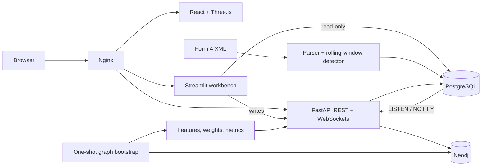
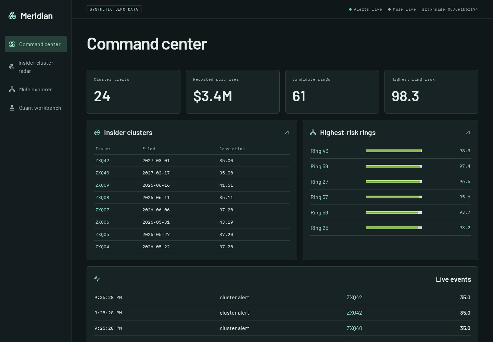
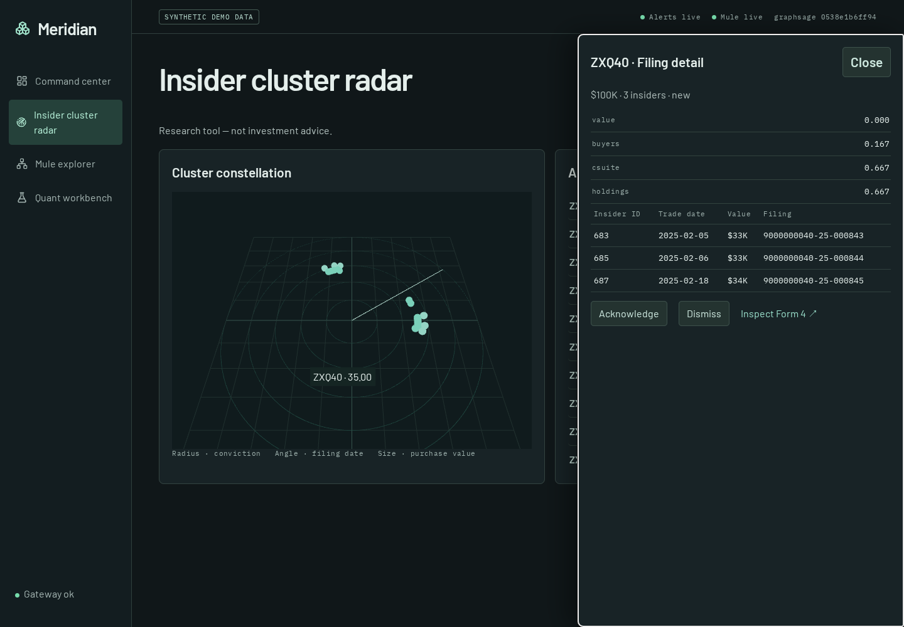
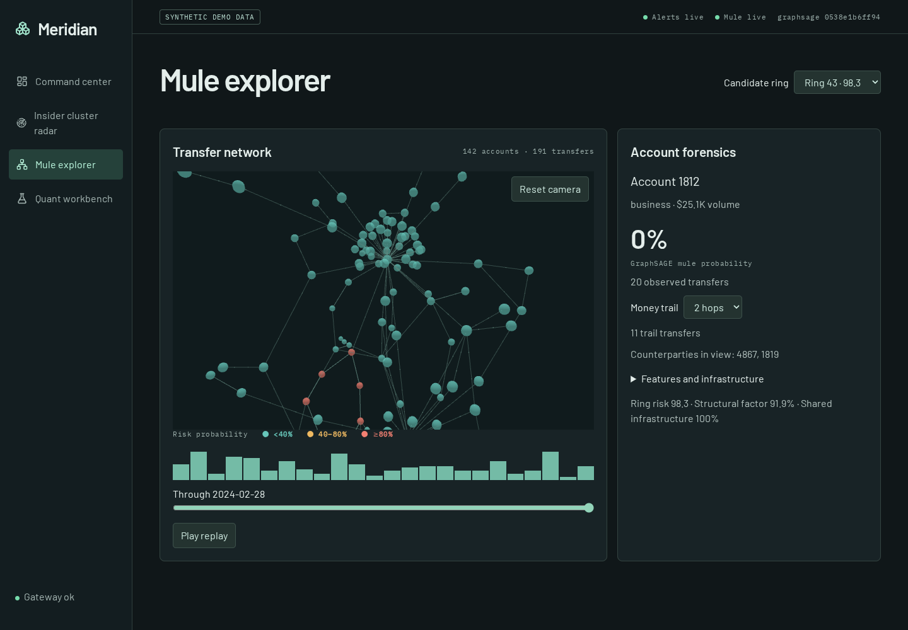
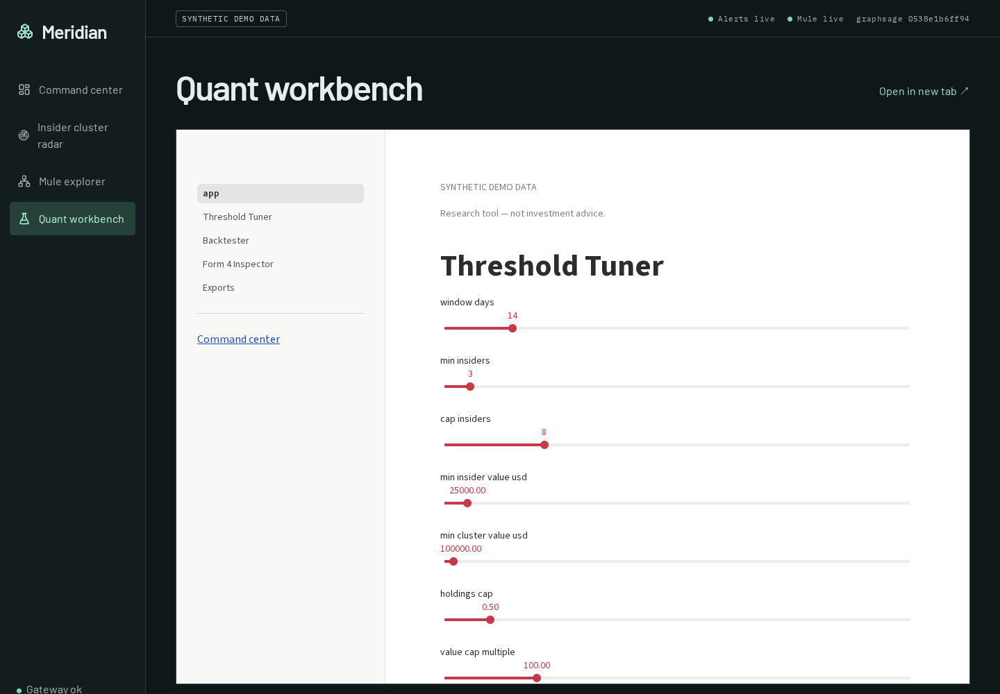

# Dual-Engine FinTech Threat & Signal Platform

Investigate clusters of insider purchases from SEC Form 4 filings and coordinated transfers in a synthetic money-mule graph. The default demo runs the parsers, detector, graph loader, model training and inference locally. Research tool — not investment advice.

## Quickstart

From a fresh clone, run:

```sh
cp .env.example .env && docker compose up --build -d --wait
```

Open [the command center](http://localhost:8080). The first start downloads native container dependencies and performs CPU training. Bootstrap exits with status 0. PostgreSQL, Neo4j, FastAPI, Streamlit and nginx continue running. To stop while preserving the database and trained model, run `docker compose down`.

Use Docker with Compose, at least 6 GB allocated to the runtime, and sufficient disk headroom for image downloads and unpacking. The verification scripts enforce a 5 GiB host free-space floor. Local development additionally uses uv, Python 3.13 and Node 22.14 or newer. Local sample credentials are in [.env.example](.env.example).

## Architecture



The detector groups qualifying purchases by issuer and distinct insider, stores conviction components, and uses filing dates for backtest availability. Replay sends a second chronological synthetic season through ingestion and detection. The mule engine builds observable graph features, finds Louvain communities, and applies GraphSAGE. The gateway publishes upward account and ring score crossings. Backend and bootstrap share a CPU-only torch/PyG image layer. Streamlit uses a separate research image.

## Two-minute demo

| Time | Action |
|---|---|
| 0:00 | Open Command Center. Check both live connections, cluster totals and the highest-risk rings. The combined feed shows events received since connecting. |
| 0:25 | Select **Insider cluster radar**, then click a sphere. Inspect conviction, member trades and filing dates. Open **Inspect Form 4** to see the source XML. |
| 0:55 | In **Mule explorer**, select a candidate ring and click a member. Compare probability with volume, counterparties, shared infrastructure and trail depth. Scrub the time window to change the visible transfers. Accounts with fewer than ten observed transfers display the cold-start curve. |
| 1:30 | Open **Quant workbench**. Try the Threshold Tuner, then use Backtester to compare forward excess returns by horizon. Saving and activating a config writes through the gateway. |

| Command center | Insider Radar with filing detail |
|---|---|
|  |  |
| **Mule Explorer with one ring selected** | **Quant Workbench** |
|  |  |

## Configuration

| Variable | Default / purpose |
|---|---|
| `DEMO_MODE` | `true` seeds synthetic Form 4 filings and prices. The mule graph is synthetic in both modes. |
| `SEED`, `MULE_SCALE` | `42`, `lite`. Lite has 6,000 accounts, 80,000 transfers and 40 planted rings. Larger presets are `demo` and `full`. |
| `GNN_ARCH`, `TORCH_NUM_THREADS` | `graphsage`, `4`. Training runs in bootstrap. The gateway loads the shipped model for scoring. |
| `RISK_ALERT_THRESHOLD`, `REPORTING_THRESHOLD` | `0.8` probability crossing; `10000` reference amount for near-threshold features. |
| `REPLAY_ENABLED`, `REPLAY_SPEED` | `true`, `1` synthetic filing week per wall-clock second. Completed weeks are persisted. |
| `SEC_USER_AGENT`, `SEC_MAX_RPS` | Set an organization name and monitored email for live requests. Default rate 8 requests/s, maximum 10. The release check caps requests at 8/s. |
| `POSTGRES_HOST`, `POSTGRES_PORT`, `POSTGRES_DB` | Host tools default to localhost, 5432 and fintech. Compose sets its internal service hostname. |
| `POSTGRES_USER`, `POSTGRES_PASSWORD` | Migration/administrative credentials. |
| `POSTGRES_APP_USER`, `POSTGRES_APP_PASSWORD`, `WORKBENCH_RO_PASSWORD` | Application writes and dedicated analyst read-only access. |
| `NEO4J_URI`, `NEO4J_AUTH` | Bolt address and login/password. The host default is bolt://localhost:7687. |
| `ORIGIN`, `DATABASE_TIMEOUT_SECONDS`, `LOG_LEVEL` | Browser origin defaults to http://localhost:8080, database timeout to 10 s and log level to INFO. |
| `ARTIFACT_DIR`, `EDGAR_CACHE`, `GATEWAY_URL` | Compose mounts trained artifacts at /artifacts, caches SEC responses at /cache and directs workbench writes to http://backend:8000. |

### Switch to live EDGAR

Stop the demo with `docker compose down`. In `.env`, set `DEMO_MODE=false`, supply your real `SEC_USER_AGENT="Organization contact@your-domain"`, and keep `SEC_MAX_RPS=8` or lower. Start a separate Compose project so its database contains only live insider filings:

```sh
docker compose -p fintech-live up --build -d --wait
curl -fsS -X POST http://localhost:8080/api/v1/insider/ingest \
  -H 'Content-Type: application/json' \
  -d '{"start":"2025-01-06","end":"2025-01-06"}'
```

Poll `GET /api/v1/insider/jobs/{id}` until the returned job completes, then submit `POST /api/v1/insider/detect` and poll its job. The API contract is in [backend/openapi.json](backend/openapi.json). The optional release check reports fetched, parsed, quarantined and P-transaction counts when a real SEC contact is configured.

## Synthetic-data results

The lite graph contains 180 mule accounts (3%) across five typologies. Both models used the same ring-disjoint five folds with legitimate accounts grouped by community. Results are mean ± sample SD across seeds 42, 43 and 44. The main evaluation uses observable topology across partitions. The final model is fitted once on all training data after CV.

| Metric | GraphSAGE | Feature-only logistic regression |
|---|---:|---:|
| PR-AUC (average precision) | 0.950 ± 0.047 | 0.692 ± 0.118 |
| ROC-AUC | 0.998 ± 0.002 | 0.985 ± 0.006 |
| Recall at 1% FPR | 0.939 ± 0.082 | 0.554 ± 0.208 |
| Cycle recall | 0.969 ± 0.083 | 1.000 ± 0.000 |
| Dispersion recall | 0.910 ± 0.178 | 0.838 ± 0.134 |
| Pass-through recall | 0.882 ± 0.120 | 0.840 ± 0.096 |
| Shared infrastructure recall | 0.905 ± 0.133 | 0.837 ± 0.189 |
| Structuring recall | 1.000 ± 0.000 | 0.981 ± 0.050 |

| GraphSAGE sensitivity check, same 15 folds | PR-AUC | Recall at 1% FPR |
|---|---:|---:|
| Age removed, account IDs remapped and creation order shuffled | 0.957 ± 0.036 | 0.955 ± 0.054 |
| Held-out accounts removed during training, then scored with their observed history | 0.910 ± 0.104 | 0.871 ± 0.192 |

Cold-start PR-AUC was **0.329, 0.424, 0.431 and 0.688** after **1, 3, 5 and 10** transfers. This used one held-out fold and the same ten positive and thirty negative accounts at each step, weighted to the eligible fold's prevalence. These values measure ranking quality. They do not calibrate an individual account's probability. [Fold-level metrics](infra/verification/phase3/metrics-lite.json)

Gate 2 detected **12 planted clusters**, with **31 trap issuers** clear. The fixture set contained 853 filings, three amendments and one malformed XML quarantine. A repeated seed inserted zero further transactions. The benchmark processed all 100,000 rolling-window entries and emitted 100 merged alerts in 0.233 s. Free live price providers can have gaps or change availability. [Verification history](PROGRESS.md)

## Verification

`make smoke` checks the running nginx origin, gateway and database health, insider and graph APIs, model metrics, and both WebSocket heartbeats. `make lint typecheck test` runs the Python and frontend checks; database integration tests use a disposable Postgres database and an ephemeral Neo4j for writes. Install development dependencies with `make install`.

**Gate 6 resets the selected Compose project and deletes its volumes.** Run `make gate-6` only on a disposable development stack. It verifies a clean checkout, collects Chromium-only SwiftShader screenshots and runs the release checks. For a browser-only rerun, use `docker compose --profile e2e run --rm e2e` after building its image. The exact results and limitations are recorded in [PROGRESS.md](PROGRESS.md).
